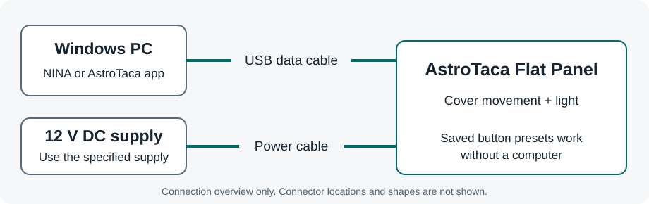
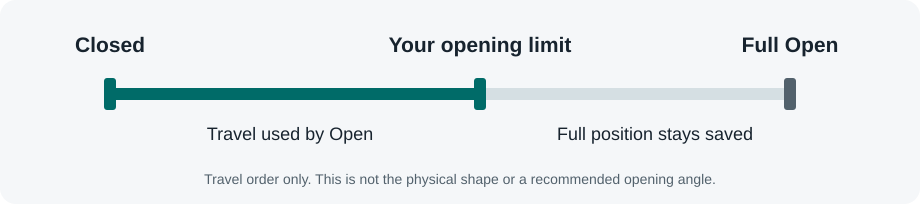
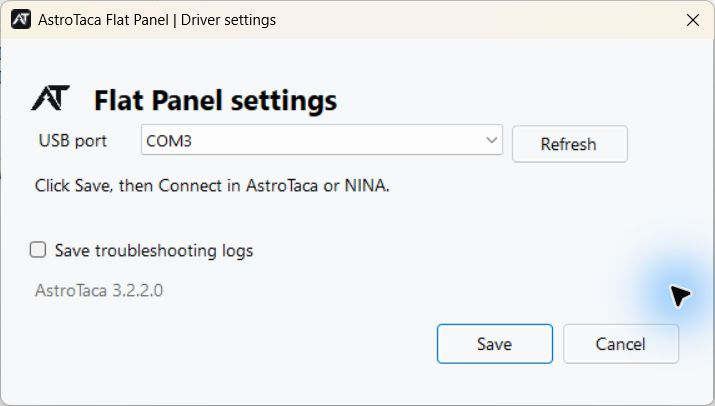
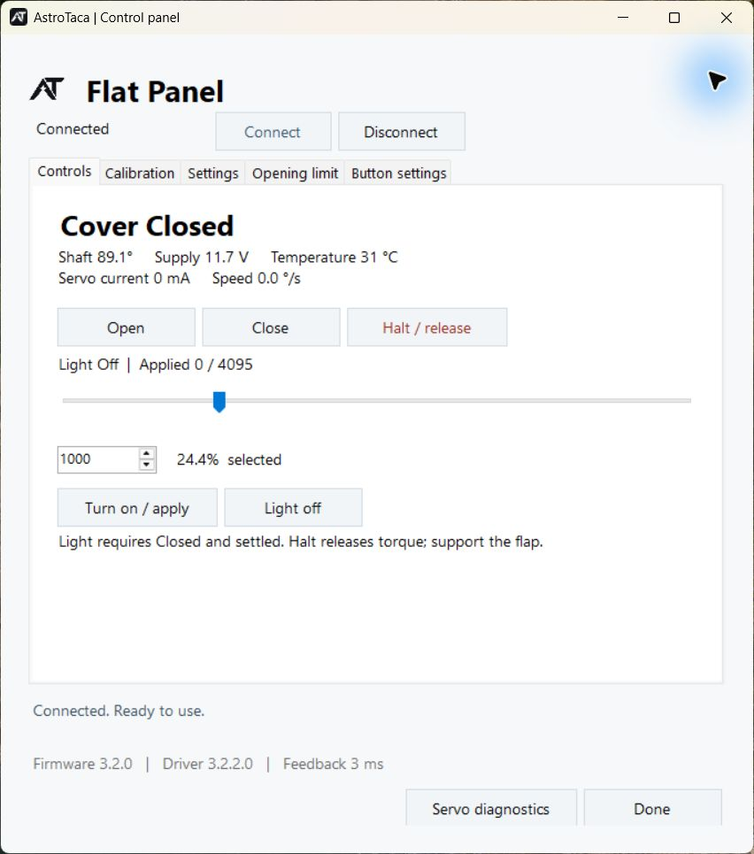
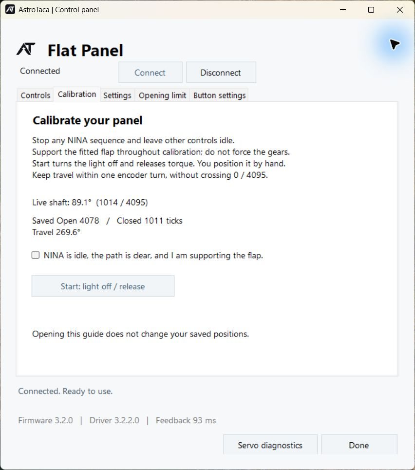
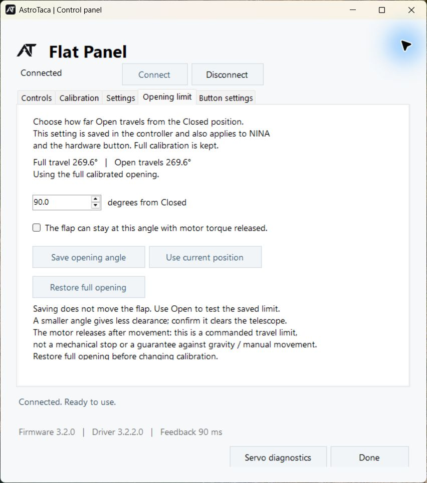
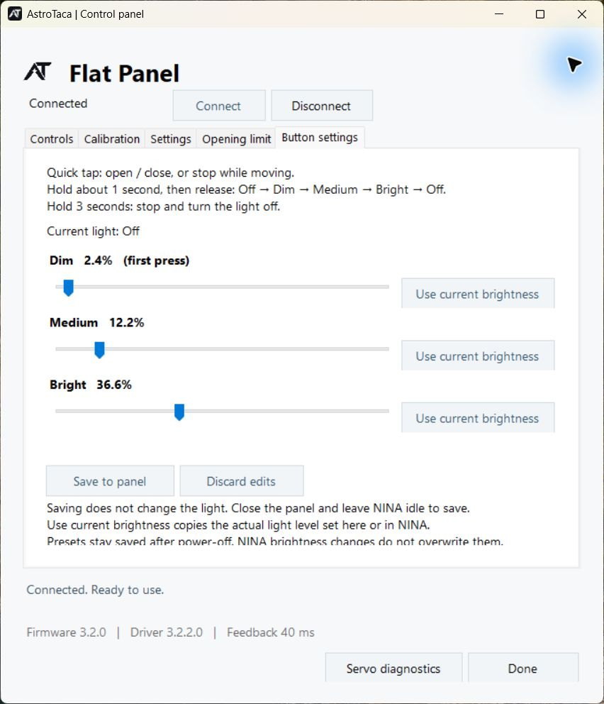

# AstroTaca Flat Panel user manual

**Pre-release draft · 16 October 2026 · Windows software 3.2.2**

AstroTaca Flat Panel combines a motorized telescope cover with an adjustable
light for taking flat frames. Use it from NINA, the AstroTaca app, or the panel's
button. Set your preferred button brightness levels once on a Windows PC, then
use those levels without a computer connected.

This guide describes the current software. The complete assembled product is
still being validated, and there is no public software release yet. Mounting,
final power specifications and product photos will be added before launch.

## Find what you need

- [First setup](#first-setup)
- [Use NINA](#use-nina)
- [Use the AstroTaca app](#use-the-astrotaca-app)
- [Set Closed and Open positions](#set-closed-and-open-positions)
- [Choose a shorter opening](#choose-a-shorter-opening)
- [Use the button and save brightness presets](#use-the-button)
- [Updates](#updates)
- [Troubleshooting](#troubleshooting)

## First setup

### Connect the panel

Keep the cover's movement path clear, including nearby cables and equipment.
Keep hands away during powered movement. Do not use the cover to push past an
obstruction.

The panel needs **USB for computer control** and **12 V DC for movement and
light**. USB alone does not power normal operation. Use a USB data cable and
the power supply specified for your product. Do not choose a supply by plug
fit alone.

**Draft limitation:** the approved supply, required current rating, connector
details and mounting instructions are not yet published. This diagram explains
the connections; it is not a wiring or installation drawing. Follow the product's
confirmed instructions before connecting or mounting a finished unit.

### Install and select the USB port

Once a public release is available:

1. Download the AstroTaca installer from [Releases](https://github.com/astrotaca/AT-Downloads/releases).
2. Close NINA and any AstroTaca windows, then run Setup. Approve the Windows
   administrator prompt, or ask the PC's administrator to install it.
3. If prompted, choose **Install ASCOM Platform** and follow its installation
   window. AstroTaca Setup continues when ASCOM is ready.
4. Open **AstroTaca Flat Panel** from the desktop or Start menu.
5. If asked, select the panel's **USB port** and choose **Save**. An existing
   saved port is kept when reinstalling or updating.
6. With the panel powered and its path clear, choose **Connect**.

The software remembers your selected port. Windows names these ports COM1,
COM2 and so on; your panel's number may differ from someone else's. If unsure,
leave the apps disconnected, unplug only the panel's USB cable, choose
**Refresh**, reconnect it and refresh again. Select the port that reappears.
See the [USB port screen](#screen-reference-usb-port).

Opening the app or saving settings does not move the cover or switch on its
light. If calibration is needed, follow [Set Closed and Open positions](#set-closed-and-open-positions)
before trying the controls. Check your physical positions with the movement
area clear before using an unattended sequence.

The current installer requires ASCOM Platform 7.1 Update 3 or later and
Microsoft .NET Framework 4.8. Setup checks these requirements. The current
draft has been exercised on Windows 11; a final supported-system list will
accompany the release.

## Use NINA

1. Go to **Equipment → Flat Panel**.
2. Select **AstroTaca Flat Panel (ASCOM)**.
3. Open the settings gear if you need to select the USB port. Save, then connect.
4. Choose **Close** and wait until the cover reports **Closed**.
5. Enter a low, nonzero brightness and choose **Set**. In NINA 3.2, this turns
   the light on at that level. Check your camera's exposure result before
   increasing brightness.
6. When finished, switch the light off. Choose **Open** when you need the
   telescope aperture clear.

**Close first, then turn on the light.** A light request while the cover is open,
moving or stopped part-way is refused. It does not close the cover for you.
Opening the cover switches the light off.

NINA 3.2 uses a number field and plus/minus buttons for brightness. The AstroTaca
app has a slider. Both control the same light; you do not need both apps open.

For an automated flat sequence, include the Close operation and allow it to
finish before requesting illumination. Keep the physical button and manual
controls idle during exposures.

## Use the AstroTaca app

Choose **Connect**, then use the **Controls** tab. See the [Controls screen](#screen-reference-controls).

| Control | What it does |
|---|---|
| **Open** | Opens to your saved opening limit, or full Open if no limit is set. |
| **Close** | Moves to the saved Closed position. |
| **Halt / release** | Stops commanded motion, turns the light off and releases motor holding force. |
| Brightness slider or number | Selects a value; moving the slider alone does not change the light. |
| **Turn on / apply** | Applies your selected brightness while Closed and settled. |
| **Light off** | Switches the light off. |

Brightness runs from **0 to 4095**. Percentages show the selected output setting,
not a measurement of light reaching your camera. Choose brightness and exposure
using your camera's flat-frame results; one setting will not suit every filter.

**Support the cover whenever motor holding force is released if it could fall
under gravity.** It is also released after normal movement. Halt is a software
control, not a physical emergency stop.

### Use alongside NINA

The app and NINA each have their own Connect/Disconnect control. Both can stay
connected together. Disconnecting or closing the AstroTaca app leaves NINA
connected. It does not undo a movement already requested.

Use only one set of controls at a time. Stop a NINA sequence before changing
calibration, opening limits or presets. To change the USB port, disconnect
NINA, the control app and any diagnostics window first.

## Set Closed and Open positions

Calibration teaches the panel where your fitted cover should stop. It is a
guided procedure in which **you gently position the cover by hand**. It does
not find a physical stop automatically. Recheck calibration if the mounting
or linkage changes.

Open **Calibration** in the AstroTaca app. You can also choose **Calibrate
panel...** from the driver's settings gear in NINA; this opens the same guide.
See the [Calibration screen](#screen-reference-calibration).

1. Choose **Connect to panel** if shown. Stop any sequence and leave other
   controls and the physical button idle throughout the guide.
2. If a custom opening limit is active, choose **Restore full opening** on the
   **Opening limit** tab first. This changes the setting without moving the cover.
3. Support the cover, clear its path and tick the readiness box. Choose
   **Start: light off / release** and wait for confirmation.
4. Gently position the cover at **Closed**, let it stop, then choose
   **Use this Closed position**. Do not force it against a stop.
5. Move gently along the intended path to **full Open**, let it stop, then choose
   **Use this Open position**. Follow the guide's permitted position range;
   do not cross the displayed angle's end-to-start rollover. If the fitted
   mechanism requires that path, stop and contact AstroTaca before proceeding.
6. Choose **Save both positions**. Saving does not move the cover.
7. Choose **Go to test controls**. With the path clear, test **Close**, then
   **Open**, waiting for each movement to finish. Check the actual cover and
   telescope clearance, not just the displayed status.

**Cancel calibration** before Save preserves the previous positions. The light
stays off and the cover remains released; cancelling does not move it back.
If connection is lost during Save, reconnect and check the saved positions
before repeating the procedure.

For a restricted installation, teach only positions that are physically safe
to reach. Never force the cover through nearby equipment to finish this guide.

## Choose a shorter opening

Use **Opening limit** when you want normal Open commands to stop sooner, for
example to keep the cover clear of nearby equipment. Your full calibration
stays saved separately. See the [Opening limit screen](#screen-reference-opening-limit).

1. Stop any sequence and wait for the cover to be stationary.
2. Open **Opening limit**. Confirm the cover can remain safely supported at the
   chosen position after the motor releases, then tick the support checkbox.
3. Enter **degrees from Closed**, then choose **Save opening angle**. Alternatively,
   support the cover and choose **Halt / release** on Controls. Wait for it to
   stop, gently place it at the desired position, then return to **Opening limit**
   and choose **Use current position**.
4. Saving does not move it. Clear the path, then choose **Open** to test the limit.
   Confirm it clears the telescope aperture as well as nearby equipment.

The saved limit applies to NINA, the app and the physical button, and remains
after power is removed. **Restore full opening** removes the limit without
moving; the next Open uses the full calibrated position.

A limit controls commanded travel. It is not a mechanical stop and cannot
prevent gravity or manual movement. Verify the fitted cover's parked position
before relying on it. Restore full opening before changing calibration.

## Use the button

The button works with or without a computer connected. The panel starts with
the light off and does not move automatically when powered on.

| Action | Result |
|---|---|
| **Quick tap** | Open or close. If already moving, stop. |
| **Hold about 1 second, then release** | While Closed: **Off → Dim → Medium → Bright → Off**. |
| **Hold 3 seconds** | Stop and turn the light off while still holding. Release causes no extra action. |

For brightness, **release the button** after about one second; do not keep
holding while waiting for the light. The cover must be Closed and settled.
A brightness press while open does not close it or turn on the light.
After a part-way stop, the next quick tap opens the cover; it does not reverse
back toward Closed.

### Set your usual brightness once

**Dim is your starting brightness** whenever the light is Off, including after
power is restored. Set Dim to the level you use most often. There is no separate
default-brightness setting and no automatic light-on at startup.
See the [Button settings screen](#screen-reference-button-settings).

1. Connect the AstroTaca app, close the cover and wait for it to settle.
2. Open **Button settings**. Adjust Dim, Medium and Bright, keeping each level
   higher than the previous one.
3. To copy a useful level from NINA or the app, apply that brightness first,
   then choose **Use current brightness** beside the desired preset.
4. Choose **Save to panel** and wait for confirmation. Saving does not change
   the current light or move the cover.
5. Turn the light off. Try four one-second press-and-release actions to check
   Dim, Medium, Bright and Off.

The saved levels remain when power is removed. A laptop is only needed to
change them; you do not need a dedicated computer for button operation.
**Discard edits** restores the currently saved values.

NINA brightness changes do not overwrite your presets. If the light is at a
level that does not match a preset, the next brightness press selects Dim. The button
remains active while NINA is connected, so leave it alone during a sequence.

## Updates

Close NINA and all AstroTaca windows, then run the newer Windows installer.
You do not need to uninstall first. Your selected USB port and the panel's
saved positions, opening limit and brightness presets are retained. After an
update, check connection and normal operation before starting a sequence.

Running the same installer again reinstalls its files. Uninstall through
**Windows Settings → Apps → AstroTaca Flat Panel**. Connection preferences
are retained for reinstall; saved panel settings are not erased.

**The Windows installer does not update panel firmware.** A customer firmware
updater is not available yet. If the app reports incompatible firmware or a
feature is unavailable, check the release notes or contact AstroTaca.

## Troubleshooting

| What you see | What to try |
|---|---|
| No USB port appears | Check the data cable, reconnect USB and choose Refresh. Try another cable or USB socket. |
| Cannot connect | Confirm the selected port, USB and 12 V supply. Read the error message. Close another application if it is using the port. |
| USB port cannot be changed | Disconnect every AstroTaca client, including NINA and diagnostics, then reopen settings. |
| Light will not turn on | Close the cover and wait for Closed. Check power and any fault message. A stopped, partly open cover cannot illuminate. |
| Slider moves but light does not change | Choose Turn on / apply in the app, or Set in NINA. |
| One-second button hold does nothing | Release it completely. Brightness changes after release, while Closed. |
| A fault or lost connection is reported | Stop the sequence, check power, cables and the movement path. Reconnect explicitly. Do not keep retrying movement into an obstruction. |
| Cover stops at a shorter angle | Check Opening limit. Restore full opening only if the full path is clear. |
| A save was interrupted | Reconnect and inspect the saved setting before retrying. Do not assume the save succeeded or failed. |

The app's **Settings** tab includes **Clear fault**. Use it only after resolving
the cause; it is not a way to bypass an obstruction or incorrect calibration.
If the fault returns, stop and ask for help.

For support, [open an issue](https://github.com/astrotaca/AT-Downloads/issues)
with your product, software version, Windows version, exact error and what you
were doing. Include a screenshot if helpful. Remove names, file paths and other
personal information from screenshots or logs before sharing them. Enable
**Save troubleshooting logs** in the driver's settings only when needed for
troubleshooting.

## Screen reference: USB port

This example opens from **Settings → USB port** in the AstroTaca app. Choose
your panel's **USB port**, then **Save**. Use **Refresh** if you have just plugged
it in. NINA's settings gear also lets you select the port; its layout may differ.

These are real windows from installed Windows software **3.2.2**. Readings and
saved values in this reference are bench examples, not recommended settings or
finished-product specifications. Your COM number may differ.

Return to [Install and select the USB port](#install-and-select-the-usb-port).

## Screen reference: Controls

Close the cover and wait for **Closed**. Choose a brightness, then **Turn on /
apply**. Moving the slider alone does not change the light. Use **Light off**
when finished.

**Halt / release** stops motion and releases holding force. Support a cover that
could fall under gravity. Readings shown here are examples.

Return to [Use the AstroTaca app](#use-the-astrotaca-app).

## Screen reference: Calibration

This guide teaches Closed and full Open. Opening the tab does not start
calibration. Read the readiness instructions and support the cover before
choosing **Start: light off / release**.

You position the cover gently by hand and save the two positions. Follow the
full procedure before starting; the example values are not targets to copy.

Return to [Set Closed and Open positions](#set-closed-and-open-positions).

## Screen reference: Opening limit

Use this tab when normal **Open** commands should stop before full Open. Check
that the cover will stay safely supported, then choose your opening angle.
Saving a limit does not move the cover.

**Restore full opening** removes the shorter limit. Check the full path is clear
before the next Open command. The displayed angles are examples.

Return to [Choose a shorter opening](#choose-a-shorter-opening).

## Screen reference: Button settings

Set **Dim** to your usual starting brightness, then choose higher Medium and
Bright levels. **Save to panel** stores all three for use without a computer.
It does not turn the light on.

Choose levels using your camera's flat exposures; these example values are not
recommendations. A one-second press followed by release cycles the levels while
the cover is Closed.

Return to [Use the button](#use-the-button).
