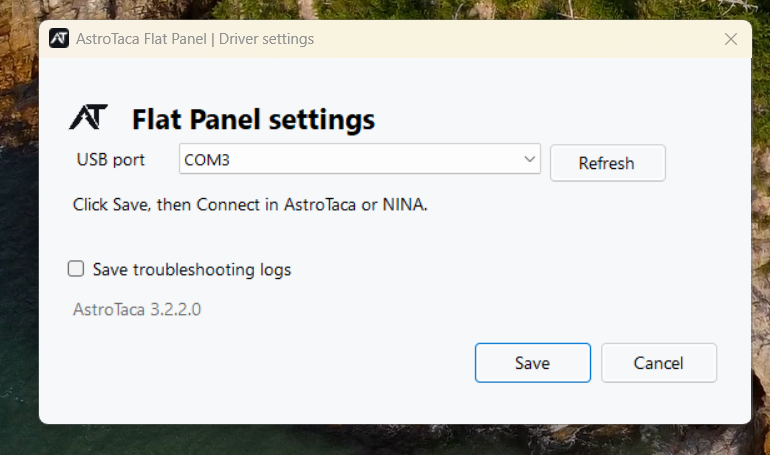
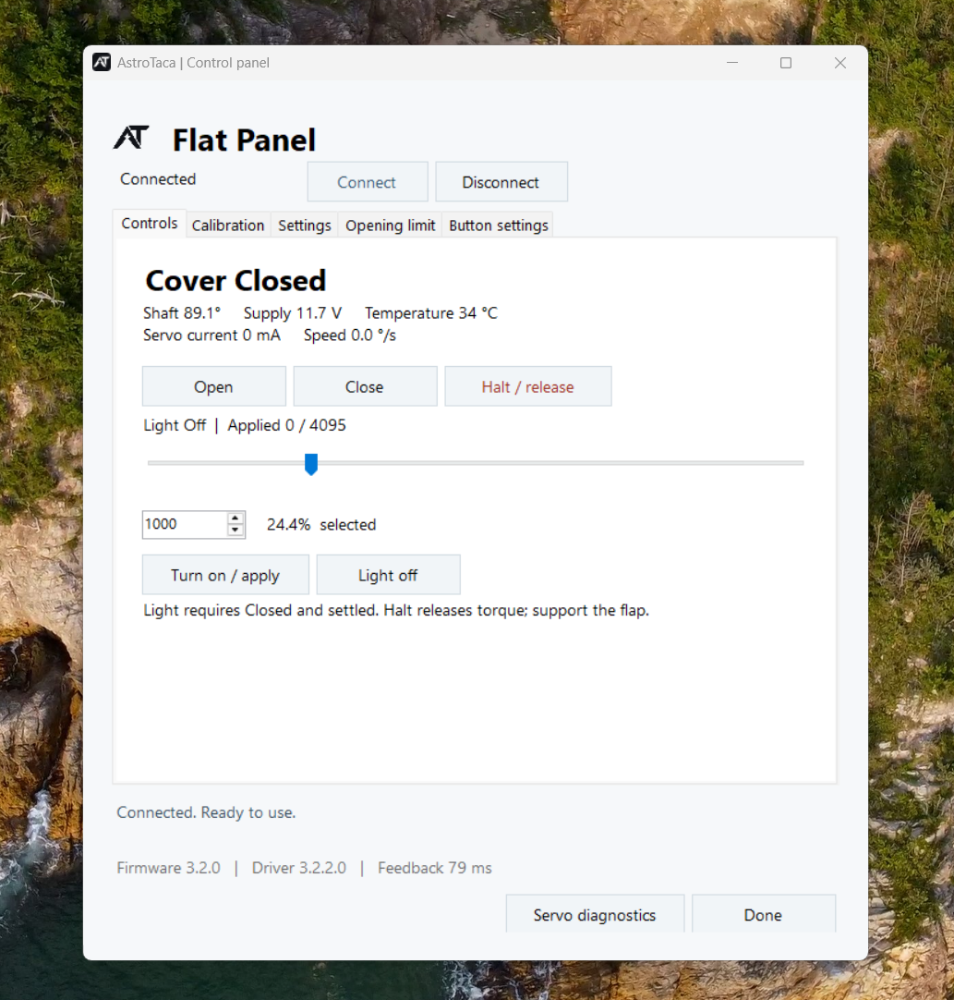
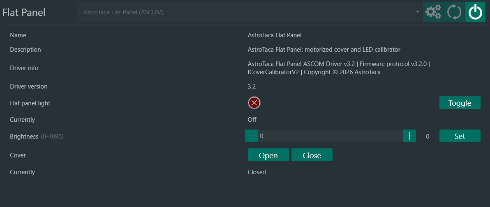
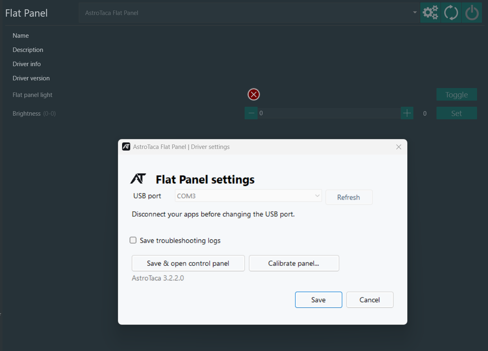
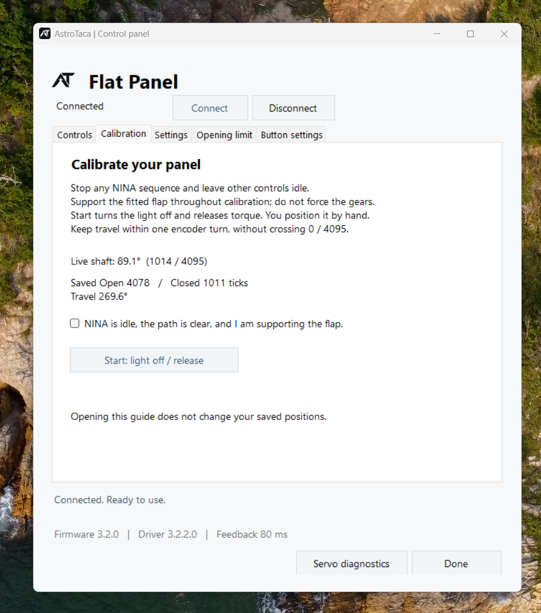
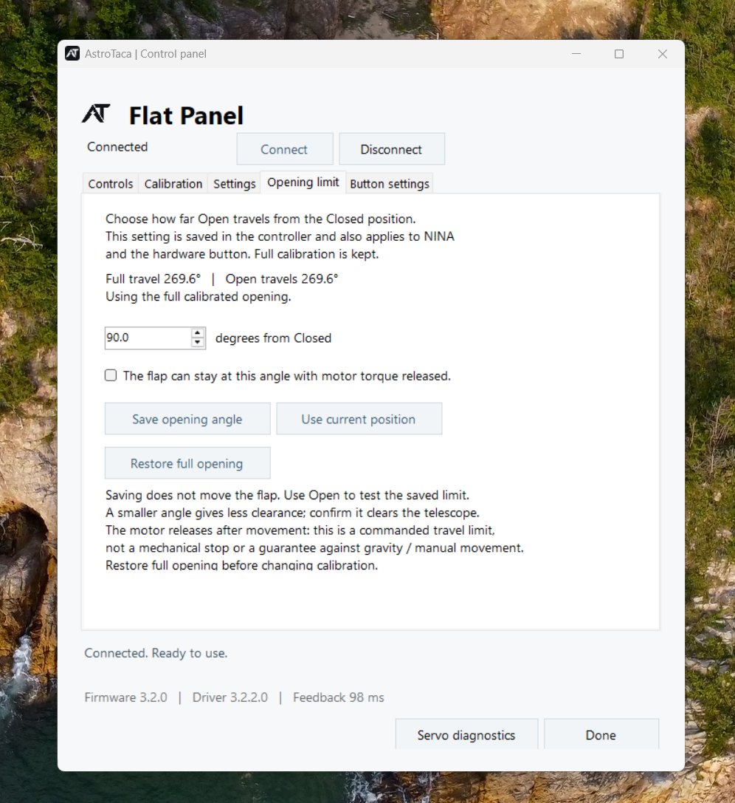
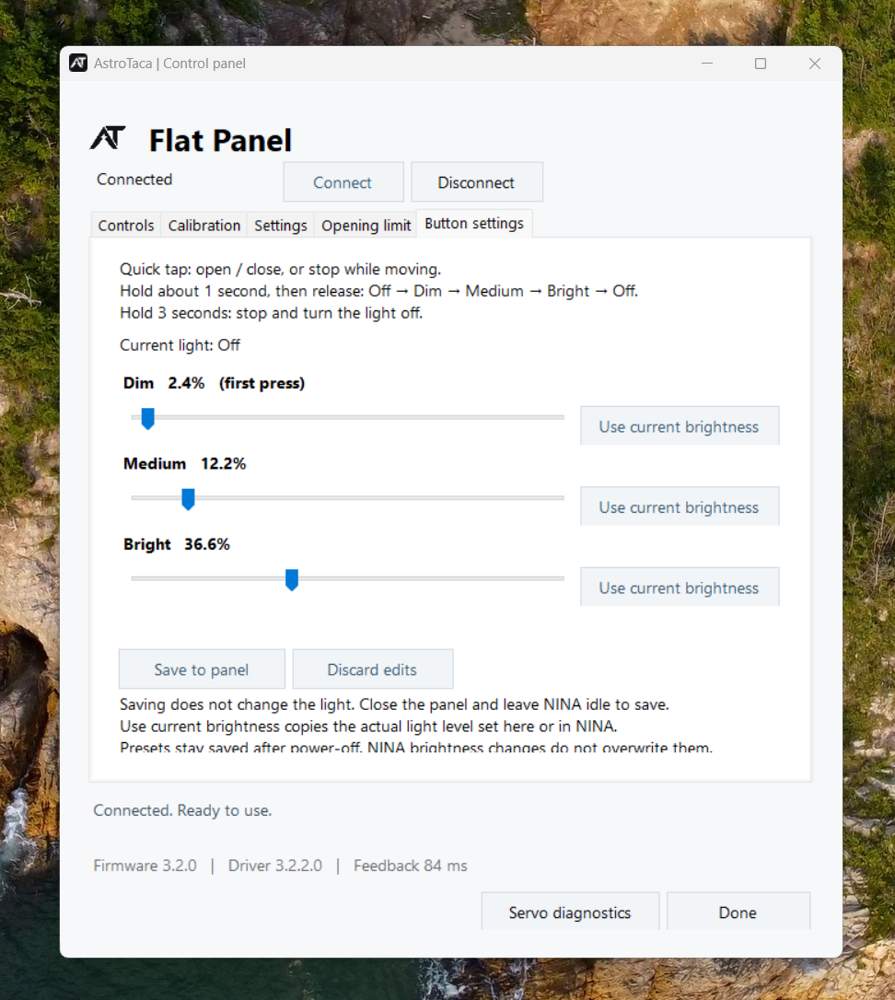

# AstroTaca Flat Panel

**Windows software 3.2.2 | 16 October 2026**

Use this guide to connect your panel, set its travel and control the light.
For mounting and power requirements, follow the instructions supplied with your panel.
Values shown in screenshots are examples, not settings to copy.

## Install and connect

1. Close NINA and any AstroTaca windows. Run the **AstroTaca Setup** file supplied with your panel.
2. If Setup asks, choose **Install ASCOM Platform** and follow its window.
3. Connect the panel's USB data cable and its specified power supply. Keep the cover's path clear.
4. Open **AstroTaca Flat Panel** from the desktop or Start menu.
5. Choose the panel's **USB port**, then **Save** and **Connect**. Your port is remembered for next time.

If you are unsure which port to choose, disconnect the app, unplug USB and click
**Refresh**. Reconnect USB and refresh again. Choose the port that reappears.
To change a saved port, open **Settings > USB port** with all clients disconnected.

If calibration is requested, [set Closed and Open](#set-closed-and-open) before using the controls.

## Use the AstroTaca app

1. Choose **Connect**, then open **Controls**.
2. Choose **Close** and wait for **Closed**.
3. Select a low brightness with the slider or number field, then choose **Turn on / apply**.
4. Choose **Light off** when finished. Choose **Open** to uncover the telescope.

Moving the slider alone does not change the light. Choose brightness using your
camera's flat exposures; the displayed percentage is an output setting.

**Close first, then light on.** The light requires Closed and settled.
Opening turns the light off.

**Halt / release** stops motion, turns the light off and releases holding force.
The motor also releases after normal movement. Support a cover that could fall
under gravity, and keep hands clear during powered movement.

## Use NINA

1. Open **Equipment > Flat Panel** and select **AstroTaca Flat Panel (ASCOM)**.
2. Use the settings gear to select the USB port if needed, then connect.

3. Choose **Close** and wait for **Closed**.
4. Enter a low, nonzero brightness and choose **Set**. This turns the light on at that level.
5. Use NINA's light control to switch it off when finished.

NINA 3.2 has a number field with plus/minus buttons. The AstroTaca app has a slider.
Both control the same brightness.

For a sequence, include **Close** before turning on the light. Leave the button
and manual controls idle during exposures. NINA and the AstroTaca app can stay
connected together; disconnecting only the app leaves NINA connected.

To teach the cover positions, open the settings gear and choose **Calibrate panel...**.

## Set Closed and Open

Calibration saves the two positions you choose by gently moving the cover by
hand. Stop any sequence and leave other controls idle while using the guide.

1. Open **Calibration** in the app, or **Calibrate panel...** from NINA's driver settings. Connect if asked.
2. If a shorter opening is active, choose **Restore full opening** on **Opening limit** first. This does not move the cover.
3. Support the cover, clear its path and tick the readiness box. Choose **Start: light off / release**.
4. Gently position the cover at **Closed**, let it stop, then choose **Use this Closed position**.
5. Gently move it to your safe full **Open** position, let it stop, then choose **Use this Open position**.
6. Choose **Save both positions**, then **Go to test controls**.
7. With the path clear, test **Close**, then **Open**. Wait for each move and check the actual clearance.

Do not force the cover against a stop. Stay within the guide's displayed position
range; do not cross from its maximum back to zero. If your mounting requires
that path, stop and contact AstroTaca.

**Cancel calibration** before saving keeps the old positions, but leaves the
light off and cover released. If a save is interrupted, reconnect and check the
saved positions before trying again.

## Limit the opening

Set a shorter opening when there is not enough room to open fully. Your full
calibration stays saved separately.

1. Stop any sequence and wait for the cover to stop.
2. Open **Opening limit** and confirm the cover will stay safely supported at the chosen position. Tick the support box.
3. Enter the desired **degrees from Closed**, then choose **Save opening angle**.
4. Clear the path and choose **Open** to check the new limit.

Alternatively, support the cover, choose **Halt / release** and wait until it stops.
Gently position it by hand, then choose **Use current position** on this tab.

The saved limit applies to NINA, the app and the button. Saving does not move the
cover. **Restore full opening** removes the limit; check the full path is clear
before the next Open. A software limit cannot prevent gravity or manual movement.

## Set button brightness

1. Connect the app, close the cover and wait for **Closed**.
2. Open **Button settings**. Set **Dim** to your usual starting brightness, then choose higher **Medium** and **Bright** levels.
3. Choose **Save to panel**. This saves the levels without moving the cover or changing the light.

To copy a level you like, apply it in the app or NINA, then choose **Use current
brightness** beside a preset. **Discard edits** returns to the saved values.

- **Quick tap:** open or close; stop if already moving. After a part-way stop, the next tap opens.
- **Hold about 1 second, then release:** while Closed, cycle **Off > Dim > Medium > Bright > Off**.
- **Hold 3 seconds:** stop and turn the light off while still holding. Release causes no extra action.

Presets stay saved without power and work without a computer. NINA brightness
changes do not overwrite them. The panel starts with its light off; the first
brightness press selects Dim.

## Updates and help

Close NINA and all AstroTaca windows, then run the newer Setup file. You do not
need to uninstall first. Your USB port, positions, opening limit and button
presets are retained. Check normal operation before starting a sequence.

The Windows installer does not update panel firmware. Follow separate firmware
instructions if AstroTaca supplies them.

- **Cannot connect:** check USB, the power supply and the selected port. Read the error shown.
- **Light will not turn on:** choose Close and wait for Closed. In the app, click Turn on / apply after selecting brightness.
- **Button brightness does not change:** release after about one second. The cover must be Closed.
- **Fault or lost connection:** stop the sequence and check power, cables and clearance. Reconnect explicitly. Use **Settings > Clear fault** only after resolving the cause.
- **Interrupted save:** reconnect and inspect the saved setting before retrying.

[Ask for help](https://github.com/astrotaca/AT-Downloads/issues) with the software
version, exact error and what you were doing. Remove personal information from
screenshots and logs. Enable **Save troubleshooting logs** in driver settings
only when needed for troubleshooting.
